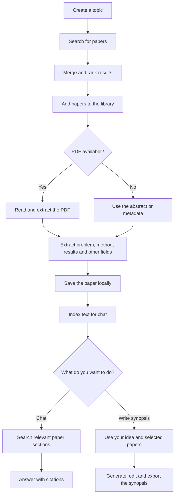
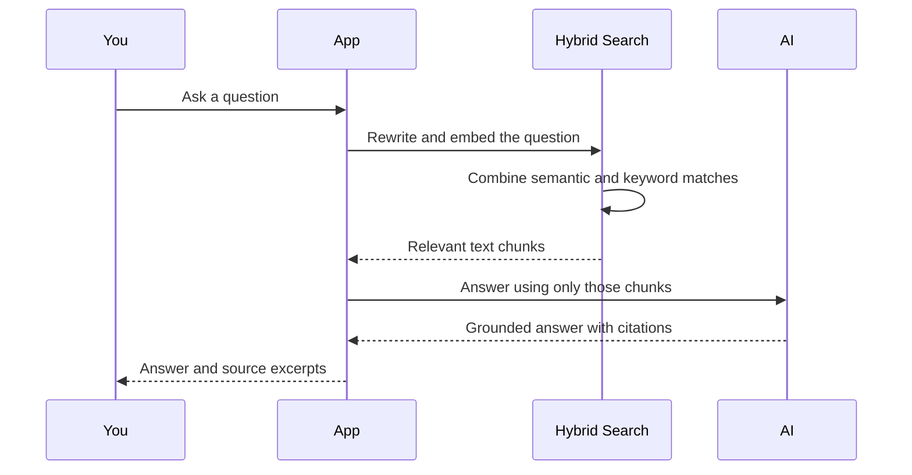

# Research Agent

Research Agent is a local Streamlit app that helps you find academic papers, extract key
literature-review information, chat with your saved papers, and write a one-page research synopsis.

It supports OpenAlex, Semantic Scholar, arXiv, and optional IEEE Xplore searches. It stores topics,
papers, chat history, and synopses in a local SQLite database.

## How it works



## Main features

- Search multiple academic sources.
- Dedupe papers found in more than one source.
- Rank results with Groq against your topic.
- Upload up to 30 PDF files.
- Extract structured information from each paper.
- Ask questions and get answers with paper, section, and page citations.
- Generate a one-page synopsis.
- Export a CSV review matrix, a Word synopsis, or Markdown.

## Setup

### 1. Create a virtual environment

```bash
cd research-agent
python3 -m venv .venv
source .venv/bin/activate
python -m pip install -r requirements.txt
```

Windows:

```powershell
python -m venv .venv
.venv\Scripts\activate
python -m pip install -r requirements.txt
```

### 2. Add API keys

Copy `.env.example` to `.env`, then add your keys:

```dotenv
GROQ_API_KEY=
GOOGLE_API_KEY=

# Optional
IEEE_API_KEY=
SEMANTIC_SCHOLAR_API_KEY=
CONTACT_EMAIL=
```

- **Groq:** relevance ranking and chat answers
- **Google AI Studio:** PDF extraction, embeddings, synopses, and chat fallback
- **IEEE API:** direct IEEE Xplore search
- **Semantic Scholar API:** avoids shared rate limits
- **Contact email:** optional OpenAlex courtesy information

Restart the app after changing `.env`.

### 3. Run

```bash
streamlit run app.py
```

Open the local address printed by Streamlit, normally `http://localhost:8501`.

## Using the app

1. **Create a topic** in the sidebar and describe what you already know.
2. **Discover papers** from the search tab.
3. **Add papers** to the library or upload PDFs.
4. **Extract papers** so the app can read their problem, method, results, limitations, and future work.
5. **Chat** with all papers or a selected group.
6. **Generate a synopsis** from your idea and the papers you choose.
7. **Edit and download** the synopsis as Word or Markdown.

## Chat flow



The chat uses Gemini embeddings and combines vector similarity with keyword (BM25) matching.
Groq generates the answer, with Gemini used as a fallback.

## Storage

The app stores data in:

```text
data/research.db
```

SQLite holds:

- Topics and topic context
- Saved papers and extracted fields
- PDF text chunks and embeddings
- Chat messages
- Saved synopses
- Cached API responses and ranking results

## PDF behavior

- PDFs with readable text are split into section and page-aware chunks.
- Scanned PDFs are sent to Gemini when a text layer is unavailable.
- If Gemini is busy, Groq may read a condensed text version instead.
- Papers without a PDF use their abstract and extracted summary for chat.

## Free API and privacy notes

- Free API tiers have rate limits and retries.
- Repeated searches and extraction requests use cached results where possible.
- API content is sent to the configured external providers.
- Free-tier Gemini prompts may be used by Google according to its current AI Studio terms.
- Do not upload confidential or unpublished work unless the provider terms and your organization permit it.
